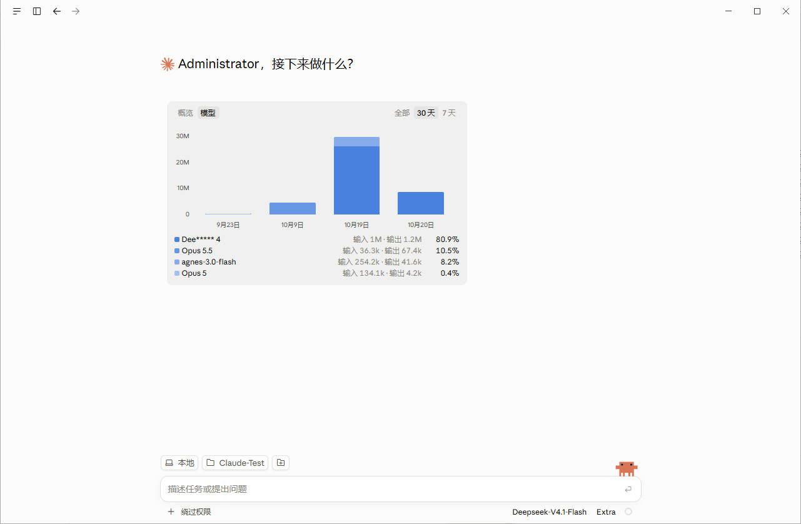
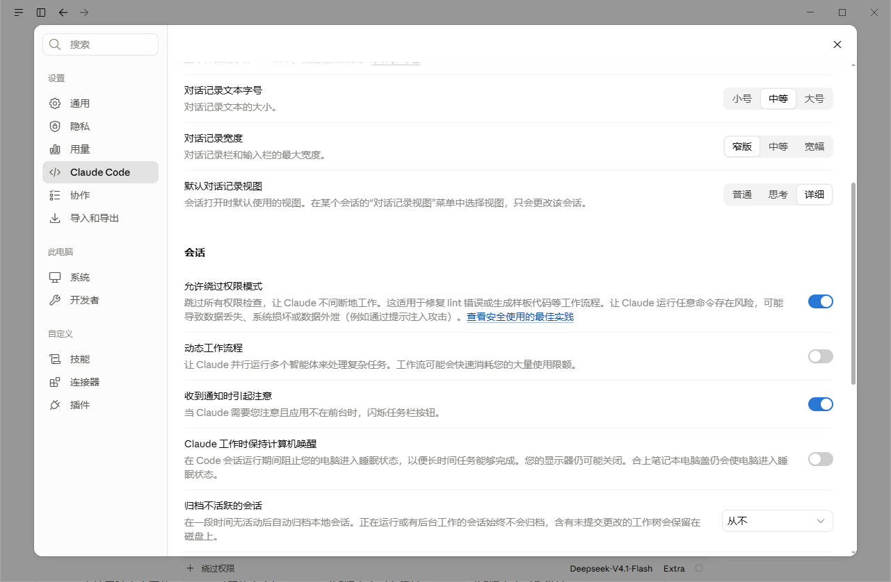

# Claude Desktop zh-CN · Windows API 客户端汉化

面向 **Windows Claude Desktop 第三方 API／网关模式**的简体中文界面补丁。

补齐桌面菜单、设置、按钮、选项和部分动态提示中的英文。适合已经配置好 API 或网关、希望使用中文界面的用户。

> 本项目是非官方界面补丁，不是独立客户端，也不提供 API、网关、账号或登录能力。

## 界面预览





## 特点

- **聚焦中文界面**：包含简体中文词库，并补译前端程序中的部分固定英文；内置输出风格显示为“简洁、解释型、学习型、主动型”，保存时仍使用原始标识。
- **英文命令，中文说明**：保留 `/compact`、`/model` 等斜杠命令的名称、别名和参数，在菜单中显示已收录说明的中文译文；未知说明及自定义内容保留原文。
- **离线安装**：词库和解析器随包提供，安装时不下载资源、不调用翻译服务。
- **两种安装方式**：可保留原件以便还原，也可选择不保留原件备份。
- **文件集中管理**：备份和状态放在补丁目录的 `.state` 中，不另建 `%LOCALAPPDATA%\ClaudeZhPatch`。
- **保留原有使用方式**：不配置网关，不改 API 地址、密钥或模型，不调整自动更新设置。
- **支持更新后重新应用**：按安装路径和应用构建隔离状态，避免旧版备份覆盖新版；不支持的结构会停止并提示。

## 使用前确认

| 项目 | 要求 |
| --- | --- |
| 系统 | Windows；使用系统自带的 Windows PowerShell |
| 运行环境 | **Node.js 22 或更新**，已加入 PATH；可运行 `node --version` 检查 |
| 客户端 | 已安装并配置好第三方 API／网关模式的 Claude Desktop |
| 默认安装路径 | `%LOCALAPPDATA%\AnthropicClaude\app-*\resources` |
| 已验证版本 | Claude Desktop **2.31226.0** 的第三方 API 模式 |

这不是免环境 EXE。没有 Node.js 的电脑需先从 [Node.js 官方网站](https://nodejs.org/) 安装运行环境；补丁不自动安装它。无需 `npm install`。

官方账号模式、Microsoft Store／MSIX 安装方式、其他系统未在本项目中完成验证，不作兼容保证。

## 安装

1. 下载 [最新 Release](https://github.com/NayutaViz/claude-desktop-zh-cn-windows-api/releases/latest) 中的运行包，**完整解压**到一个长期保留、可写入的本地目录。
2. 保存工作，并从 Claude 菜单退出应用。仅关闭窗口可能仍在后台运行。
3. 双击 **`安装汉化.cmd`**，选择安装方式。
4. 完成后重新打开 Claude。

```text
[1] 安装汉化并备份（推荐，可一键还原）
[2] 安装汉化但不备份（无法一键还原）
[0] 退出
```

**建议选 1。** 它只备份补丁涉及的原始资源，并记录语言字段原值；备份位于补丁自身目录，不需要在 C 盘另留一个目录。普通用户安装目录通常不需要管理员权限；程序不会自动提权或强制结束 Claude。

### 选项 2 的区别

选项 2 不新建原始资源备份，也不保存原语言设置，只在 `.state` 留下校验清单和覆盖报告。

- 无法通过 `还原汉化.cmd` 完整恢复。需要恢复时，应使用官方安装器修复／重装客户端。
- 普通写入异常会尝试使用本次进程的内存副本回滚；断电、强制结束进程后无法保证恢复。
- 同一版本、同一份补丁可重复运行；同一客户端构建上更换补丁版本会被拒绝，需先恢复官方原版，或更新客户端后再安装。
- 已有可还原安装时，不会直接删除它的备份：先还原，再选择选项 2。之前已经留下的原件仍保留，避免悄悄丢失备份。
- 其实是方便洁癖。

## 还原与检查

- **`还原汉化.cmd`**：退出 Claude 后运行，还原当前构建的原始资源及原语言字段；不会回退后来修改的其他配置。
- **`检查状态.cmd`**：查看当前构建、资源校验结果、安装模式和状态目录。`filesIntact: true` 表示已安装资源与清单一致。

安装和还原前会检查文件。发现其他工具修改过的资源时会停止，避免覆盖未知修改。请勿叠加不同来源的汉化补丁。

更改 Claude 的显示语言不等于卸载：部分固定英文已在前端资源中被替换，切回 English 后这些文字仍可能显示中文。要完整恢复请使用备份还原。

## 更新 Claude 之后

重新运行 `安装汉化.cmd`，补丁会检测最新的 `app-*` 目录。新构建单独记录状态，旧备份不会用于覆盖新构建。

新版新增而词库尚未覆盖的词条保留英文，并写入覆盖报告。若资源目录、语言列表或前端语法发生较大变化，可能需要更新本补丁；**不保证兼容所有未来版本**。

本项目不修改更新策略。已经启用或禁用的自动更新设置保持原样。

## 文件与备份

```text
claude-desktop-zh-cn-windows-api/
  安装汉化.cmd
  还原汉化.cmd
  检查状态.cmd
  README.md
  LICENSE
  lib/                       程序、词库、解析器及第三方许可
  .state/                    首次使用时生成；不随发布包分发
    <构建标识>/
      manifest.json          当前安装清单
      coverage.json          词条覆盖报告
      baseline.json          原始备份索引，仅备份模式
      original/              原件，仅备份模式
```

需要一键还原时，保留整个 `.state`。将补丁移到其他文件夹时，把 `.state` 一起移动；复制给另一台电脑时不要附带本机 `.state`，让目标电脑自行建立备份。

早期版本若使用了 `%LOCALAPPDATA%\ClaudeZhPatch`，先把其中的构建子目录移动到当前补丁的 `.state` 内，不要覆盖同名目录。旧目录确认空了再删除。检测到未迁移的旧备份时，新脚本会提示并停止。

## 工作原理与覆盖范围

项目对外使用 `zh-CN` 名称；为兼容 Claude 的语言加载机制，补丁内部仍安装 `zh-Hans` 中文语言资源，注册前端语言列表，并使用 Acorn 解析 JavaScript，在已知显示属性、条件分支、数组和模板字符串中替换收录的文案。内置输出风格只处理显示名称；自定义风格保持原名。HTML 标签白名单、工具参数说明和内部状态标识不作为界面文案处理。配置只改 `locale` 字段，不保存完整用户配置。

修改范围为安装目录中的外置语言资源、前端 JavaScript 和用户配置的语言字段；**不改 `Claude.exe` 或 `app.asar`**。

在已验证版本中，桌面英文词条 **801 条**、前端英文词条 **34,213 条**均有对应资源，已检查格式及变量。这是资源层面的覆盖，不代表逐一验证了所有页面。用户输入、聊天内容、代码、路径、产品名和模型名不作为翻译对象；第三方扩展、远程页面及服务端返回的原始报错可能仍为英文。

## 常见问题

**为什么不能只放一个中文文件？** 该版本的本地前端还有语言白名单和直接写在程序里的英文，因此完整补译需要修改部分前端资源。它不是官方插件机制，原件备份仍有价值。

**为什么提示 Claude 仍在运行？** 从应用菜单或托盘退出后重试。补丁不会强制结束会话。

**为什么提示已有补丁操作？** 窗口会显示扫描、写入、校验进度和操作耗时。安装需要解析界面资源，还原需要校验原件，因此仍需一些时间；请以窗口进度为准。若另一操作仍在运行，会显示其 PID 和开始时间，请等待完成。进程已经退出留下的锁会自动清理；锁信息损坏时才需要确认无补丁进程后手动移除 `.state/operation.lock`。不要强行关闭正在写入的窗口。备份模式中断后可尝试还原；不备份模式中断后需先修复官方原版。

**安装失败或界面仍有英文？** 提交 Issue 时附上 Claude 版本、Windows 版本、安装模式、错误文字或已遮盖隐私的截图。不要上传 `.state`、用户配置、API 密钥或聊天记录。

## 命令行与开发

默认检测安装位置：

```powershell
node lib/patch.cjs install
node lib/patch.cjs install-no-backup
node lib/patch.cjs restore
node lib/patch.cjs status
```

自定义位置可在动作后传入 `resources` 路径，第三个参数可指定状态目录：

```powershell
node lib/patch.cjs install "D:\Apps\Claude\app-2.31226.0\resources" "D:\ClaudePatchState"
```

开发和发布检查无需安装 npm 依赖：

```powershell
npm test
npm run check
npm run release
```

打包采用明确的文件清单，生成运行版、源码版 ZIP 和 SHA-256 校验文件；`.state`、审查材料和本机配置不会进入压缩包。

## 致谢与许可

感谢以下资源的维护者：

- **翻译资源**：词库结合 Claude 自带中文资源、[官方中文词库](https://claude.ai/i18n/zh-Hans.json)、[javaht/claude-desktop-zh-cn](https://github.com/javaht/claude-desktop-zh-cn) 的翻译及本项目补译，并非全部原创。上游资源最初取用版本标记为 1.4.12 的快照，MIT 许可原文见 [lib/THIRD-PARTY-LICENSE.txt](lib/THIRD-PARTY-LICENSE.txt)。未运行或分发上游安装器。
- **JavaScript 解析器**：[Acorn 8.19.0](https://github.com/acornjs/acorn)，MIT 许可原文见 [lib/ACORN-LICENSE.txt](lib/ACORN-LICENSE.txt)。

本项目自有代码及原创贡献采用 [MIT 许可](LICENSE)。第三方资源保留各自权利和许可，本项目许可不为官方中文资源重新授予权利。Claude、Anthropic 名称仅用于说明适用对象，本项目与 Anthropic 无隶属关系。
